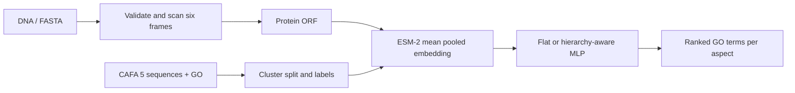

# ProtFunc

ProtFunc converts a DNA sequence into its longest translated open reading frame, embeds the protein with ESM-2, and ranks Gene Ontology (GO) function hypotheses for molecular function (MF), biological process (BP), and cellular component (CC). Predictions are computational hypotheses, not experimental validation.



## Quickstart

### Windows (PowerShell)

Clone the repository, create and activate a Python 3.12 environment, install CPU-only PyTorch and the app/test dependencies, run the tests, then launch the app:

```powershell
git clone https://github.com/PNBhoomika/ProteinPred.git
cd ProteinPred
py -3.12 -m venv .venv
.\.venv\Scripts\Activate.ps1
python -m pip install torch==2.7.0 --index-url https://download.pytorch.org/whl/cpu
python -m pip install -r requirements-app.txt
python -m pip install -r requirements-dev.txt
python -m pytest
python -m uvicorn api.main:app --host 127.0.0.1 --port 8000
```

Open <http://127.0.0.1:8000>. The first prediction needs internet access to download ESM-2 8M from Hugging Face (about 30 MB); the model is cached afterward.

### macOS / Linux

Clone the same repository, create/activate a Python 3.12 venv (`python3.12 -m venv .venv`, then `source .venv/bin/activate`), and run the same dependency install, test, and Uvicorn commands above. Install the PyTorch build appropriate for your platform if the Windows CPU-wheel command is not suitable.

This is inference only; bulk embedding extraction and training stay in the GPU notebooks. Kaggle's training dependencies are pinned separately in `requirements-train.txt` and are installed by the notebook setup cells.

## Reproduce training

Training and bulk embedding extraction are intended for a Kaggle/Colab GPU session; do not run these steps on a low-memory laptop. Follow [the training runbook](docs/TRAINING_RUNBOOK.md) and execute notebooks 01 then 02. Both notebooks use the required CAFA 5 competition paths, fixed seed 42, and write work products beneath `/kaggle/working/`. Notebook 01 subsamples up to 40,000 sequences no longer than 512 aa, propagates GO `is_a` ancestors, selects up to 200 terms per aspect (edit `TOP_K` to change), clusters at 30% identity using MMseqs2, and caches float16 ESM-2 embeddings in shards. The ESM-2 checkpoint is configurable as `MODEL_NAME`. Notebook 02 compares a three-head flat MLP, hierarchy-constrained MLP, and post-hoc hierarchy enforcement. The optional DIAMOND section uses only training sequences.

Run `python scripts/make_results_table.py` after copying measured `results/metrics.csv` here. The table below is generated only from that file; no results are included until it exists.

<!-- RESULTS TABLE START -->
| Model | Aspect | F-max | Micro F-max | Mean term AP | Rare-term F-max | Frequent-term F-max |
|---|---|---:|---:|---:|---:|---:|
| flat | MF | 0.47375003808509475 | 0.43212439144054043 | 0.17720179122712726 | 0.14579978670904337 | 0.5033159416440317 |
| flat | BP | 0.33869602179768066 | 0.3401793517498195 | 0.18830661851988878 | 0.18585393424150526 | 0.3861996030047994 |
| flat | CC | 0.533841436242638 | 0.5144636536890824 | 0.16854993242872007 | 0.1372980120355897 | 0.5558014291448448 |
| flat_posthoc | MF | 0.47477604883183494 | 0.4326115775519222 | 0.17678298893596367 | 0.14579978670904337 | 0.5040841980656222 |
| flat_posthoc | BP | 0.33915194617021616 | 0.3404118768522189 | 0.1876865577249449 | 0.18595736709365288 | 0.38671922383807045 |
| flat_posthoc | CC | 0.5353791867523494 | 0.5155160840605153 | 0.16976659217145607 | 0.13765217202901286 | 0.556927995854618 |
| hierarchy | MF | 0.47300525356745415 | 0.43091190108191657 | 0.17346108875009975 | 0.14180964124940218 | 0.5000369142676452 |
| hierarchy | BP | 0.331034397378478 | 0.334976852056759 | 0.1930119210699841 | 0.17902528499180534 | 0.38072577252370676 |
| hierarchy | CC | 0.5247263121696433 | 0.5076305220883534 | 0.1752009166025366 | 0.13505836976065874 | 0.5445828535995375 |
| diamond_top_hit | MF | 0.31380896117226836 | 0.2995352556094148 | 0.12786127684760987 | 0.23024016157169952 | 0.3263600983176836 |
| diamond_top_hit | BP | 0.26131709365801564 | 0.23468453919035312 | 0.10973443943068893 | 0.1746285974943589 | 0.29230476047578524 |
| diamond_top_hit | CC | 0.3384519680050916 | 0.32372515513985073 | 0.09002508080348982 | 0.12335043238999575 | 0.3555750797957219 |
<!-- RESULTS TABLE END -->

## Results and limitations

The table above is generated from `results/metrics.csv`. On a 30%-identity cluster split, the ESM-2 flat classifier has higher F-max than DIAMOND top-hit transfer for MF, BP, and CC. The hierarchy-aware model does not improve F-max over flat: MF is effectively tied given the marginal difference in the CSV, and BP and CC are slightly lower. Post-hoc hierarchy enforcement gives only a negligible gain, about +0.001 F-max. DIAMOND has higher `rare_fmax` than flat for MF.

This is a single run with one seed and no confidence intervals. Many test proteins had no DIAMOND hit; `results/diamond/hits.tsv` contains substantially fewer hit records than the test set has proteins, which lowers DIAMOND's F-max. Identity-bin evaluation was not run, so these results describe performance on a 30%-identity cluster split, with no bin-wise conclusion. The hybrid model, calibration, and deployment are not implemented.

## Demo

The app serves `models/hierarchy.pt`, the hierarchy-aware model. The following real app run used human ubiquitin back-translated into DNA with one common codon per amino acid. This is a synthetic test sequence, not a natural gene:

```text
ATGCAGATTTTTGTGAAAACCCTGACCGGCAAAACCATTACCCTGGAAGTGGAACCGAGCGATACCATTGAAAACGTGAAAGCGAAAATTCAGGATAAAGAAGGCATTCCGCCGGATCAGCAGCGTCTGATTTTTGCGGGCAAACAGCTGGAAGATGGCCGTACCCTGAGCGATTATAACATTCAGAAAGAAAGCACCCTGCATCTGGTGCTGCGTCTGCGTGGCGGCTAA
```

The longest ORF was frame +1, bases 0–231, complete, with 6 other candidates. Its protein was `MQIFVKTLTGKTITLEVEPSDTIENVKAKIQDKEGIPPDQQRLIFAGKQLEDGRTLSDYNIQKESTLHLVLRLRGG`.

MF ranked binding (60.0%) and protein binding (52.7%) highest, followed by catalytic activity (14.2%). BP ranked biological regulation, regulation of biological process, and regulation of cellular process at 26.4%, followed by cellular process and response to stimulus at 25.1%. CC ranked cellular anatomical entity and intracellular anatomical structure at 37.6%, followed by cytosol (36.0%), cytoplasm (27.6%), and protein-containing complex (20.1%).

The input is a synthetic back-translation, not a natural gene. Scores are model outputs, not calibrated probabilities. Predictions are computational hypotheses. The app serves the hierarchy-aware model.

**Known limitation:** no minimum ORF length is enforced, so a short random sequence containing an ATG can still return predictions.

The trained models used for the reported results are included in `models/`, so you can run the app without retraining. To retrain from scratch, see `docs/TRAINING_RUNBOOK.md`.

`fmax` is protein-centric: it macro-averages per-protein precision over proteins with predictions and recall over proteins with true labels at each threshold. `micro_fmax` is the retained pooled version. `mean_term_ap` is mean per-term average precision. Rare/frequent F-max uses term frequencies from the training split.

## Limitations and reduced scope

- Training labels come from CAFA 5 protein annotations; DNA is only the inference-time interface.
- GO label propagation uses `is_a` edges only. The three ontology roots (`GO:0003674`, `GO:0008150`, `GO:0005575`) are excluded from evaluation and model term lists.
- Only up to 200 frequent GO terms per aspect are modeled. GO annotation coverage is incomplete and biased.
- MMseqs2 clustering is preferred. If installation or clustering fails, the notebook records a random protein split fallback; this does not provide the same sequence-leakage protection and must be disclosed with results.
- ESM-2 is frozen. Models are basic MLPs with BCE, without calibration, S-min, identity bins, hybrid fusion, or LoRA.
- The optional DIAMOND baseline is intentionally separated and may be skipped.
- The API performs single-sequence CPU embedding and may take time on CPU. Bulk embeddings and training belong in a GPU notebook.
- `PROJECT_SPEC.md` describes a wider research project; this repository implements the reduced scope from the task.
